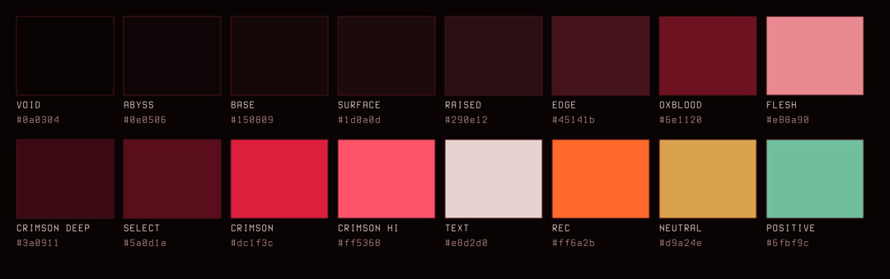
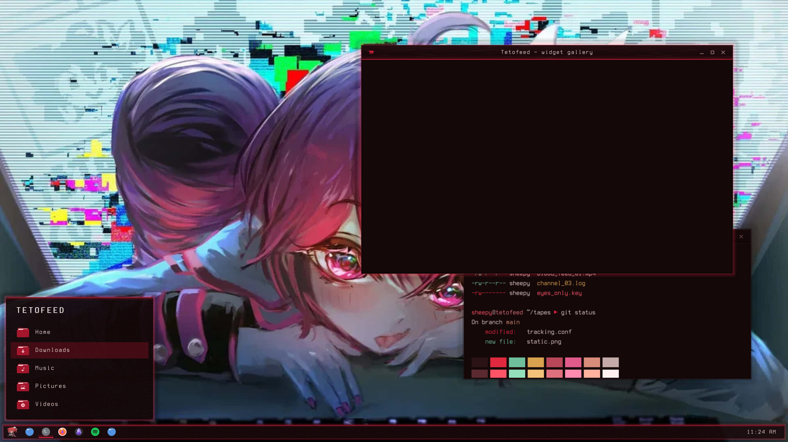

# Tetofeed — Colour Scheme

Blood-black KDE colour scheme with a crimson accent and muted selections, sampled from a twindrilled VHS wallpaper.



Tetofeed is a red twindrilled VHS look for KDE Plasma 6, built around a crimson-lit face on near-black: blood-black surfaces, faint scanlines and tape grain, and a slight crimson glow on whatever has focus.

## Features

- The surfaces are red-black, never pure #000: window `#150809`, views `#0e0506`, headers `#1d0a0d`, borders `#45141b`.
- Crimson `#dc1f3c` for the accent, focus and hover, with a dim oxblood `#5a0d1a` for selections, so a selected row glows without shouting.
- Bone text `#e8d2d0`. Negative is a hotter scarlet-orange `#ff6a2b` so errors never blend into the accent; teal for positive, muted amber for neutral.
- The titlebar colours are set too, for Breeze decorations.



## Requirements

Plasma 5 or 6.

## Install

```bash
git clone https://github.com/sheepy1335/tetofeed-colors
cd tetofeed-colors && ./install.sh
```

Or from the KDE Store: System Settings → Colors & Themes → Colors → Install from File, or copy to `~/.local/share/color-schemes/`.

## The rest of the suite

| piece | repo |
|---|---|
| SDDM login | [tetofeed-sddm](https://github.com/sheepy1335/tetofeed-sddm) |
| Plymouth boot splash | [tetofeed-plymouth](https://github.com/sheepy1335/tetofeed-plymouth) |
| Global theme + splash screen | [tetofeed-global](https://github.com/sheepy1335/tetofeed-global) |
| Plasma style (panel, popups) | [tetofeed-plasma](https://github.com/sheepy1335/tetofeed-plasma) |
| Aurorae window decoration | [tetofeed-aurorae](https://github.com/sheepy1335/tetofeed-aurorae) |
| Kvantum widget style | [tetofeed-kvantum](https://github.com/sheepy1335/tetofeed-kvantum) |
| Icon theme | [tetofeed-icons](https://github.com/sheepy1335/tetofeed-icons) |
| Konsole + kitty colours | [tetofeed-konsole](https://github.com/sheepy1335/tetofeed-konsole) |

Everything at once, with the generators: [tetofeed](https://github.com/sheepy1335/tetofeed).

## Tags

`tetofeed` `kde` `plasma6` `dark` `vhs` `scanlines` `crimson` `red` `blood` `horror` `retro` `analog-horror` `glow` `color-scheme` `colour-scheme` `dark-theme` `kdeglobals`

## Credits and licence

By sheepy1335. GPL-3.0-or-later.
